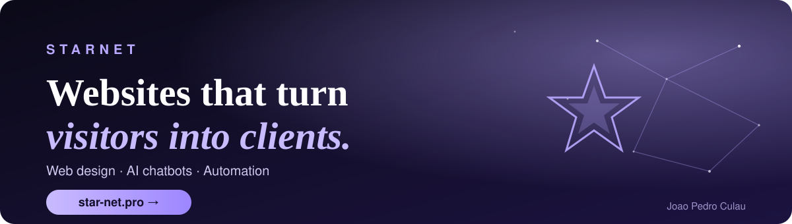
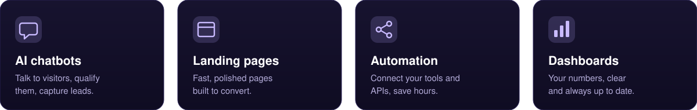

## My work
*Concept sites for fictional brands, built to show range. Click any image to open the live page.*

<table>
<tr>
<td align="center" width="50%"> <b>Forno Nonna</b> Restaurant: ordering and reservations</td>
<td align="center" width="50%"> <b>Volt Nutrition</b> Shopify-style store: bundles and subscriptions</td>
</tr>
<tr>
<td align="center"> <b>Pipeflow CRM</b> SaaS landing page: pricing and free trial</td>
<td align="center"> <b>Northline Motors</b> Dealership: finance calculator and test drives</td>
</tr>
<tr>
<td align="center"> <b>Aurora Analytics</b> B2B product page with live-style charts</td>
<td align="center"> <b>Vault &amp; Co.</b> Luxury pre-launch page with countdown</td>
</tr>
<tr>
<td align="center"> <b>Freelance Launchpad</b> Video sales page for an online course</td>
<td align="center">  <b>Want something like this for your business?</b>  <a href="https://star-net.pro">star-net.pro</a>  <a href="https://www.upwork.com/freelancers/~015aca805aa070eec1">Hire me on Upwork</a></td>
</tr>
</table>

## See the AI assistant working
Open **[star-net.pro](https://star-net.pro)** and describe your project. It reads the job and makes the case for the fit, live.

## How I work
- Built with AI-assisted development, so turnaround is fast.
- I start from your exact problem: send me the job and I'll tell you how I'd approach it.
- Clear scope, honest estimates.

<b><a href="https://star-net.pro">star-net.pro</a></b>  ·  <a href="https://www.upwork.com/freelancers/~015aca805aa070eec1">Upwork</a>

