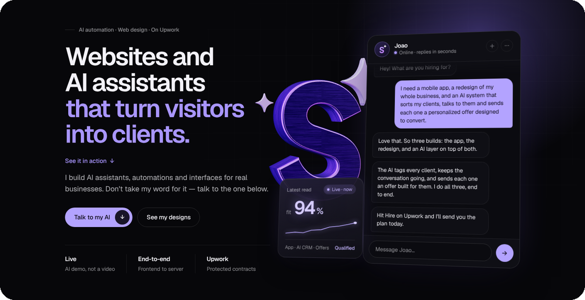
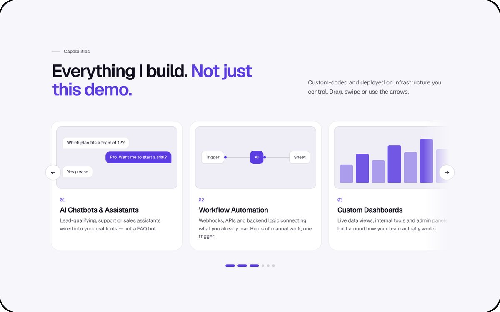
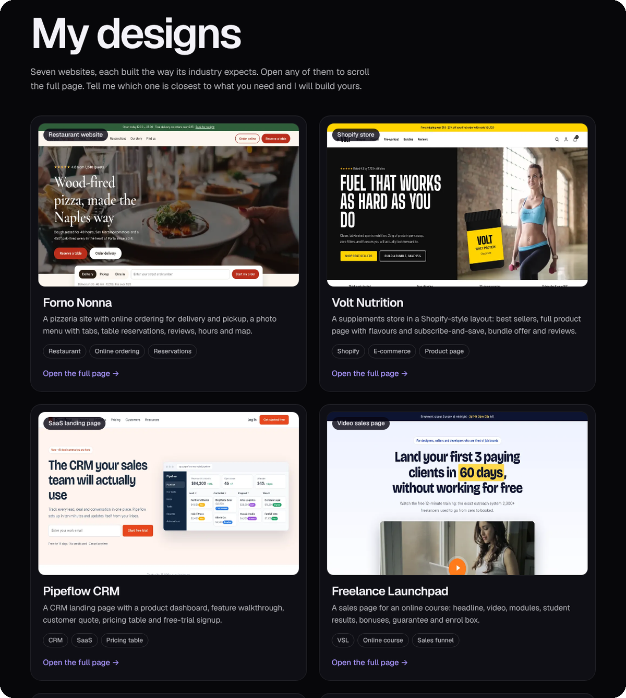
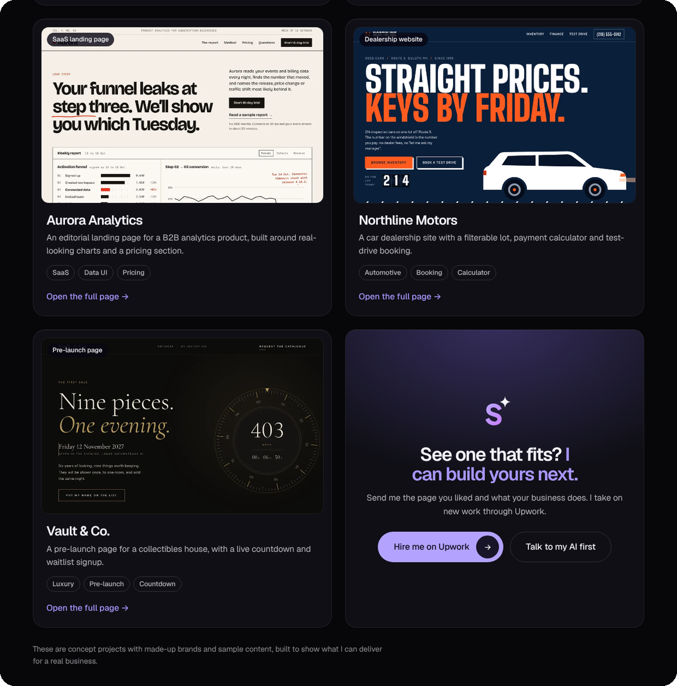
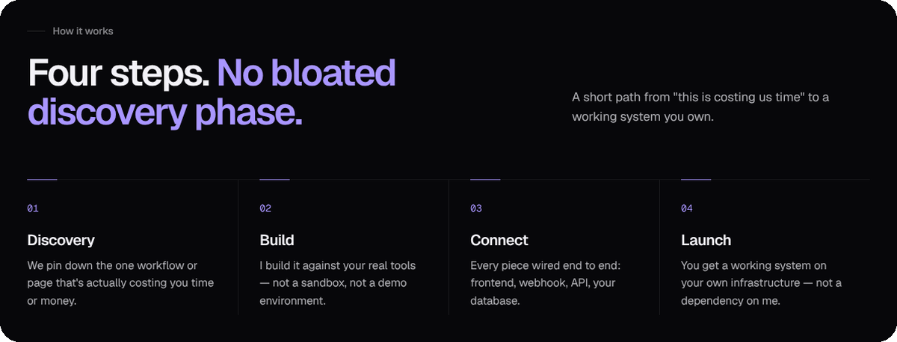
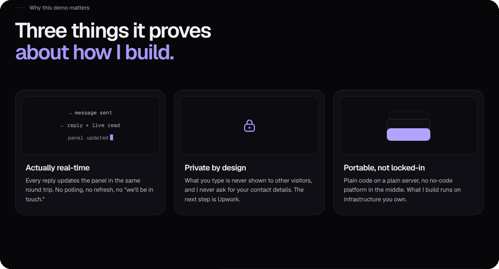
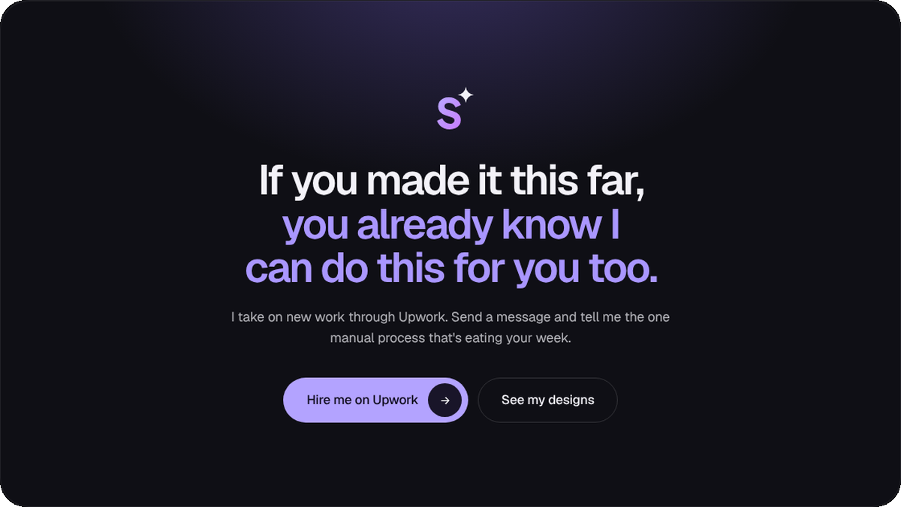

  

<h3 align="center">Don't hire from a portfolio. Hire from what it just did.</h3>

  <a href="https://star-net.pro/#demo"><b>Talk to my AI &rarr;</b></a>
  &nbsp;&nbsp;·&nbsp;&nbsp;
  <a href="https://star-net.pro"><b>star-net.pro</b></a>
  &nbsp;&nbsp;·&nbsp;&nbsp;
  <a href="https://www.upwork.com/freelancers/~015aca805aa070eec1"><b>Hire me on Upwork &rarr;</b></a>

 

  

 

  

  

 

  

 

  

 

  

Joao Pedro Culau · Starnet · <a href="https://star-net.pro">star-net.pro</a>

