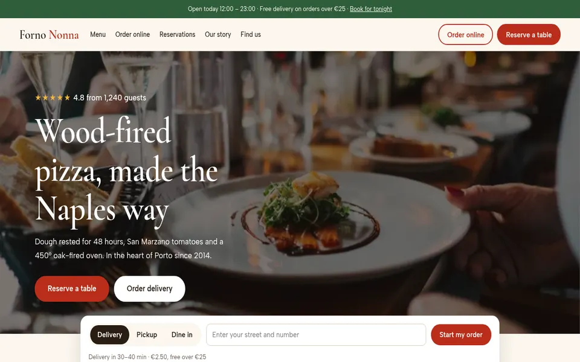
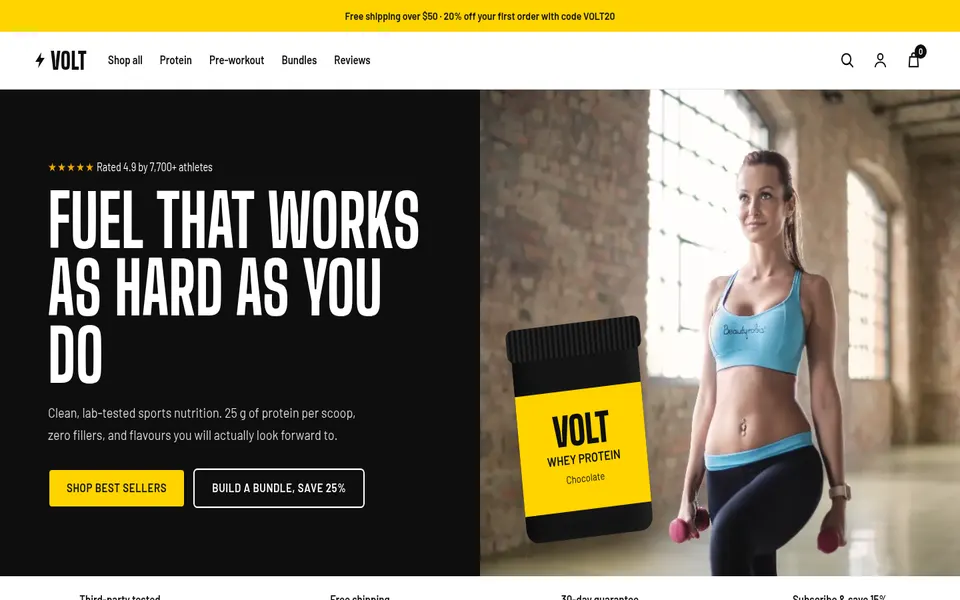
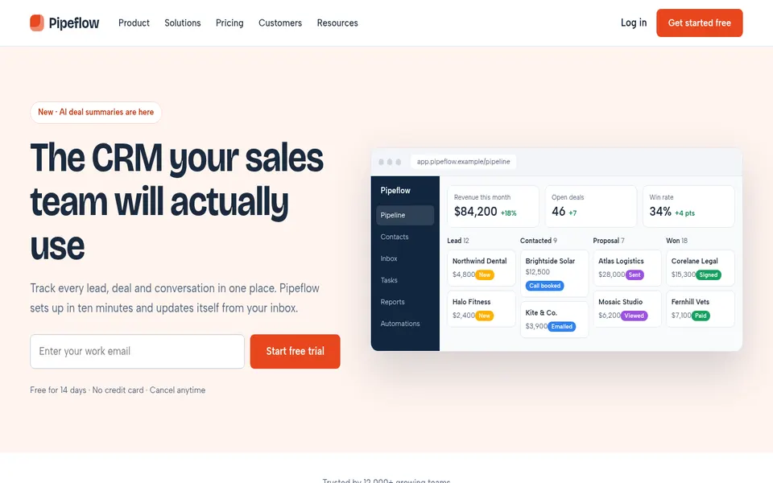
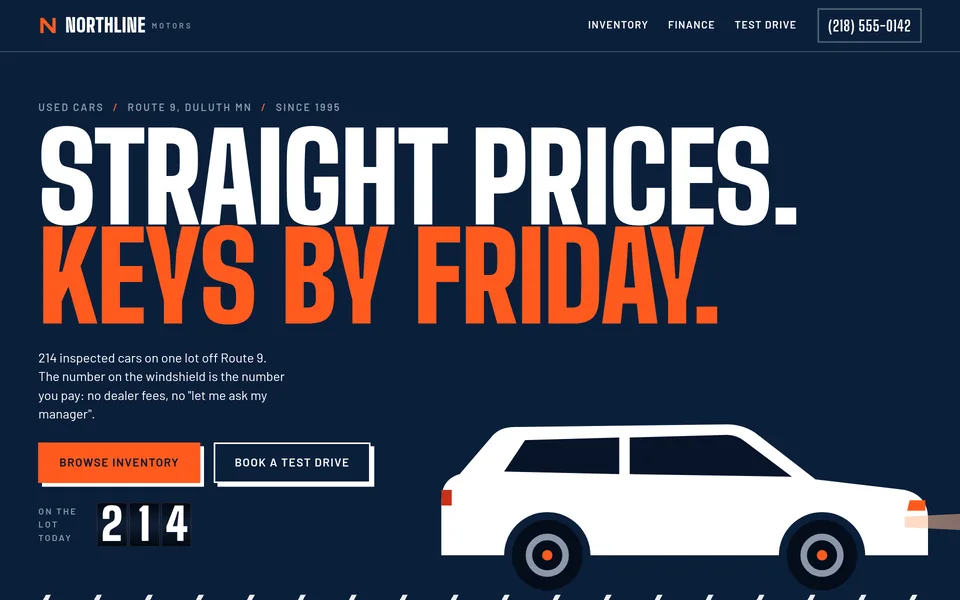
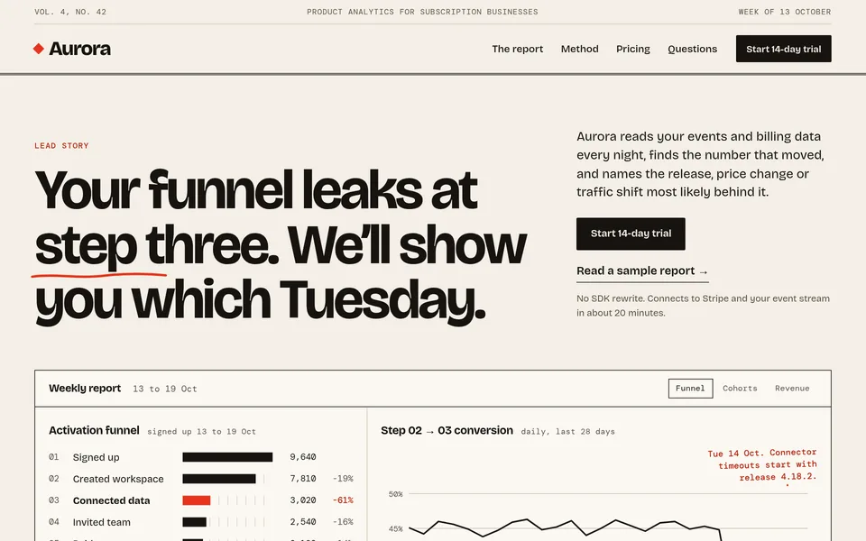
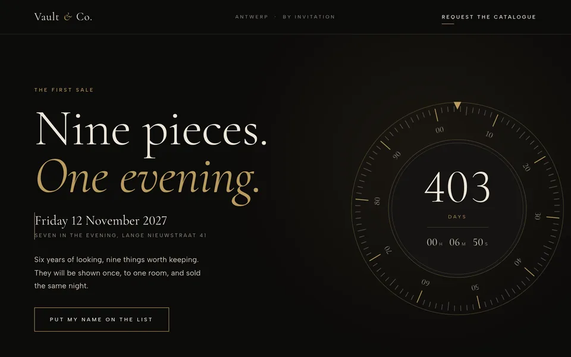
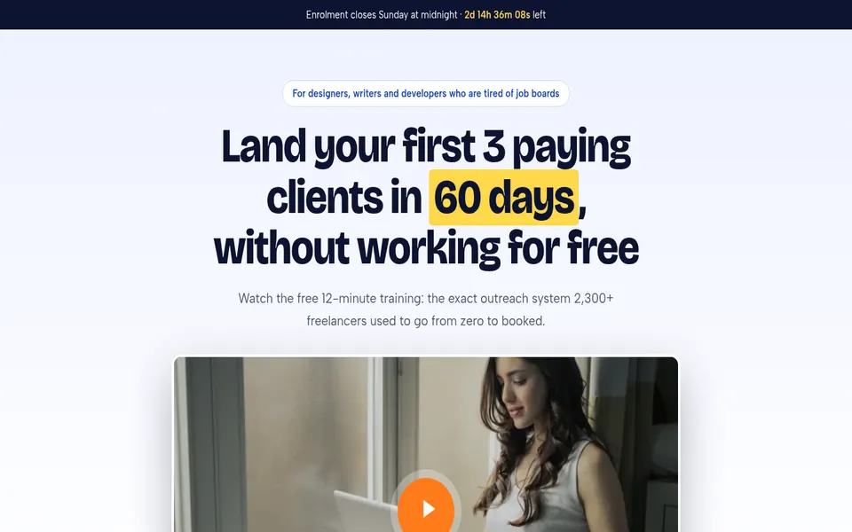

# Joao Pedro Culau

**Web design and AI chatbots, under the Starnet brand.**
I build fast, modern websites with AI assistants that qualify leads and send them straight to your CRM.

**Portfolio:** [star-net.pro](https://star-net.pro)  ·  **Hire me on Upwork:** [my profile](https://www.upwork.com/freelancers/~015aca805aa070eec1)

## My work
*Concept sites for fictional brands, built to show range. Click any image to open the live page.*

<table>
<tr>
<td align="center" width="33%"> <b>Forno Nonna</b> Restaurant: ordering and reservations</td>
<td align="center" width="33%"> <b>Volt Nutrition</b> Shopify-style store: bundles and subscriptions</td>
<td align="center" width="33%"> <b>Pipeflow CRM</b> SaaS landing page: pricing and free trial</td>
</tr>
<tr>
<td align="center"> <b>Northline Motors</b> Dealership: finance calculator and test drives</td>
<td align="center"> <b>Aurora Analytics</b> B2B product page with live-style charts</td>
<td align="center"> <b>Vault &amp; Co.</b> Luxury pre-launch page with countdown</td>
</tr>
<tr>
<td align="center"> <b>Freelance Launchpad</b> Video sales page for an online course</td>
<td align="center" colspan="2"> <b>Want something like this for your business?</b> Send me an invite on Upwork.</td>
</tr>
</table>

## What I build
- AI chatbots and assistants that talk to visitors, qualify them and capture leads
- Landing pages that convert
- Workflow automation and API integrations
- Custom dashboards

## See the AI assistant working
Open [star-net.pro](https://star-net.pro) and describe your project. It reads the job and makes the case for the fit, live.

## How I work
- Built with AI-assisted development, so turnaround is fast.
- I start from your exact problem: send me the job and I'll tell you how I'd approach it.
- Clear scope, honest estimates.
